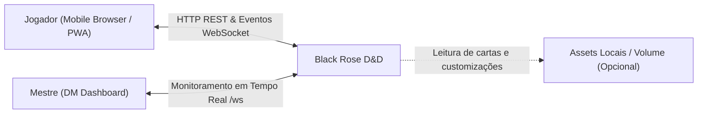
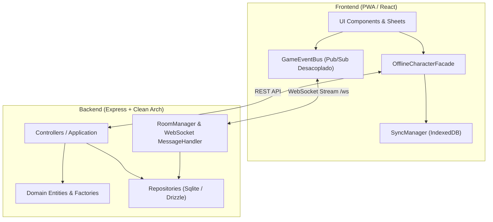
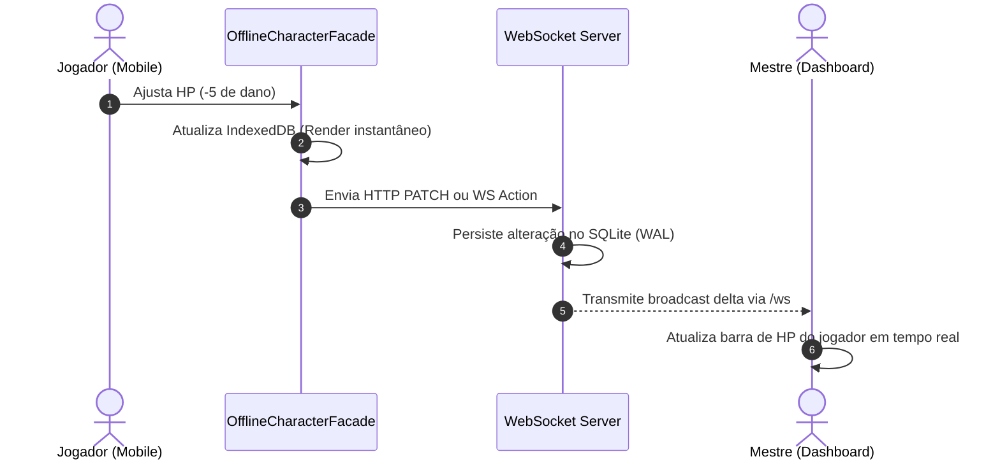

# 🌹 Black Rose D&D 5e — Architectural Documentation (arc42)

> **Mobile-first, Offline-first D&D 5th Edition Character Sheet & Real-Time DM Companion**  
> Construído com foco em resiliência, performance em mesas presenciais e conformidade estrita com as diretrizes do **D&D 5e System Reference Document (SRD 5.1)** sob licença **CC-BY-4.0**.

---

## 📑 Sumário Executivo

1. [1. Introdução e Metas](#1-introdução-e-metas)
2. [2. Restrições de Arquitetura](#2-restrições-de-arquitetura)
3. [3. Contexto e Escopo](#3-contexto-e-escopo)
4. [4. Estratégia da Solução](#4-estratégia-da-solução)
5. [5. Visão dos Blocos de Construção (Building Blocks)](#5-visão-dos-blocos-de-construção-building-blocks)
6. [6. Visão de Execução (Runtime View)](#6-visão-de-execução-runtime-view)
7. [7. Visão de Implantação (Deployment View)](#7-visão-de-implantação-deployment-view)
8. [8. Conceitos Transversais (Cross-Cutting)](#8-conceitos-transversais-cross-cutting)
9. [9. Decisões de Arquitetura (ADRs)](#9-decisões-de-arquitetura-adrs)
10. [10. Requisitos de Qualidade](#10-requisitos-de-qualidade)
11. [11. Riscos e Segurança](#11-riscos-e-segurança)
12. [12. Atribuição Legal e Licença](#12-atribuição-legal-e-licença)

---

## 1. Introdução e Metas

O **Black Rose D&D** é um ecossistema projetado para agilizar o gerenciamento de fichas de personagens de D&D 5ª Edição e a condução de combates pelo Mestre (DM) em mesas presenciais e remotas, priorizando ergonomia móvel e tolerância a quedas de conexão.

### 1.1 Objetivos de Negócio & Funcionais

- **Ficha Móvel de Alta Densidade**: Interface touch pensada para smartphones com ajustes de vida instantâneos (`-5`, `-1`, `+1`, `+5`), tracking de dados de vida, slots de magia e ações de combate.
- **Painel em Tempo Real do Mestre (DM Dashboard)**: Visão agregada de iniciativa, HP e status de todos os jogadores conectados via WebSockets em tempo real.
- **Catálogo & Grimório Desacoplado**: Consulta de magias e itens com busca rápida e suporte a fallback nativo quando imagens não estiverem configuradas.
- **Resiliência Offline-First (PWA)**: Capacidade de jogar e alterar a ficha mesmo sem internet no local da partida, sincronizando automaticamente ao reconectar.

### 1.2 Stakeholders

| Papel | Expectativa Principal |
| :--- | :--- |
| **Jogador (Player)** | Velocidade para atualizar HP, gastar slots e lançar magias em segundos sem telas lentas. |
| **Mestre (Dungeon Master)** | Monitoramento de iniciativa e vida da mesa em tempo real sem ter que perguntar a cada rodada. |
| **Desenvolvedor / Comunidade** | Arquitetura limpa, testável, livre de infraestrutura pesada e respeitosa aos direitos autorais. |

---

## 2. Restrições de Arquitetura

### 2.1 Restrições Técnicas & Operacionais

- **Banco Embutido Zero-Config**: Utilização do SQLite nativo do Node.js (`node:sqlite` + Drizzle ORM) no modo WAL, sem exigir instâncias externas de PostgreSQL ou Redis.
- **Mobile Target**: Funcional em qualquer navegador moderno mobile via Progressive Web App (PWA) e Service Worker.

### 2.2 Restrições Legais e Propriedade Intelectual (Copyright)

- **SRD 5.1 Compatibility**: O repositório inclui exclusivamente dados sob licença **Creative Commons Attribution 4.0 International (CC-BY-4.0)** da *Wizards of the Coast LLC*.
- **Sem Assets Proprietários no Código-Fonte**: Imagens comerciais de cartas de magias, artes protegidas e dumps com dados pessoais de campanhas privadas **não são distribuídos** no repositório. O sistema foi construído para funcionar com dados abertos e renderizar fallbacks visuais limpos.

---

## 3. Contexto e Escopo

### 3.1 Contexto de Negócio



### 3.2 Contexto Técnico

- **Frontend SPA**: React 18, Vite, Tailwind CSS, Lucide Icons, Service Worker (Workbox).
- **Backend API**: Node.js 22+, Express, Native SQLite (`DatabaseSync`), Drizzle ORM, WebSocket (`ws`).
- **Autenticação**: Bearer Tokens JWT com hash de senhas via `bcrypt`.

---

## 4. Estratégia da Solução



1. **Anti-Prop Drilling com `GameEventBus`**: Substituição de dezenas de props repassadas hierarquicamente por um barramento de eventos desacoplado e tipado.
2. **Offline-First com `OfflineCharacterFacade`**: Qualquer mutação na ficha é aplicada instantaneamente no cache local do cliente e despachada para sincronização assíncrona, eliminando latência perceptível para o jogador.
3. **Tratamento de Erros Funcional (`neverthrow`)**: Uso consistente do padrão `Result<T, E>` em camadas de repositório e serviços para garantir que nenhum erro seja ignorado silenciosamente e evitar lançamentos caóticos de exceções.

---

## 5. Visão dos Blocos de Construção (Building Blocks)

### 5.1 Estrutura de Diretórios

```
black_rose_dnd/
├── backend/
│   ├── src/
│   │   ├── application/       # Controllers HTTP e orquestração
│   │   ├── config/            # Schema DDL, instâncias de DB e SQLite nativo
│   │   ├── data/              # Compêndio SRD 5.1 JSON (CC-BY-4.0)
│   │   ├── domain/            # Entidades ricas, contratos e KitFactories
│   │   ├── infrastructure/    # Implementações concretas de repositórios (Drizzle)
│   │   ├── routes/            # Definições de rotas Express (auth, characters, spells)
│   │   └── websocket/         # Salas de DM e mensageria em tempo real
│   └── test/                  # Testes unitários e de integração (Vitest)
├── frontend/
│   ├── src/
│   │   ├── components/        # Componentes UI atômicos e abas da ficha
│   │   ├── context/           # GameEventBus e contextos compartilhados
│   │   ├── domain/            # Tipos e regras do cliente
│   │   ├── hooks/             # Custom hooks reativos
│   │   ├── offline/           # Fachada offline, IndexedDB e SyncManager
│   │   └── services/          # Cliente de API resiliente (requestSafe)
│   └── test/                  # Testes unitários de hooks e serviços
├── apoio/                     # Guias técnicos de Clean Code, SOLID e Patterns
├── docker-compose.yml         # Orquestração de containers com persistência em volume
└── Dockerfile                 # Multi-stage build (Node 22)
```

---

## 6. Visão de Execução (Runtime View)

### 6.1 Sincronização em Tempo Real (Mestre & Jogadores)



---

## 7. Visão de Implantação (Deployment View)

### 7.1 Produção com HTTPS Automático via Caddy (Recomendado)

O projeto inclui orquestração com **Caddy Reverse Proxy**, que gerencia certificados SSL/TLS automaticamente via Let's Encrypt / ZeroSSL, habilita compressão moderna (zstd/gzip) e proxy transparente para WebSockets (`/ws`).

```bash
# 1. Copie o arquivo de exemplo de ambiente e informe seu domínio
cp .env.example .env
# Defina DOMAIN=rpg.seusite.com no .env

# 2. Suba o ambiente de produção completo com HTTPS
docker compose -f docker-compose.prod.yml up --build -d
```

### 7.2 Execução Rápida via Docker Compose (Sem Caddy / Local)

```bash
docker compose up --build
```

Acesse: **`http://localhost:4000`**

### 7.3 Execução em Desenvolvimento Local

#### Backend (Porta 4000)

```bash
cd backend
npm install
npm test       # Executa os 22 testes unitários do backend
npm run dev    # Inicia a API com recarregamento dinâmico
```

#### Frontend (Porta 3000)

```bash
cd frontend
npm install
npm test       # Executa os 18 testes unitários do frontend
npm run dev    # Inicia servidor Vite com hot-reload
```

---

## 8. Conceitos Transversais (Cross-Cutting)

### 8.1 Segurança & Sanitização

- **Validação Estrita na Borda (Zod)**: Todos os corpos de requisições (`req.body`) de registro, login, criação de ficha, ataques e itens são validados e tipados por schemas Zod antes de atingir as camadas de domínio ou persistência.
- **Proteção contra Força Bruta (Rate Limiting)**: Os endpoints `/api/auth/login` e `/api/auth/register` possuem rate limiting restrito (10 tentativas por minuto por IP) via `express-rate-limit`.
- **Headers de Segurança HTTP (Helmet)**: Proteção ativa contra clickjacking, MIME-type sniffing e injeções através de headers como X-Content-Type-Options e Strict-Transport-Security (HSTS).
- **Reverse Proxy Readiness**: Configuração `app.set('trust proxy', 1)` para identificação fidedigna do IP do cliente e protocolo seguro atrás de proxies (Caddy, Cloudflare, Nginx).
- **Zero Secrets Hardcoded**: Chaves JWT e credenciais são passadas estritamente via variáveis de ambiente com validação em tempo de inicialização em produção.
- **Proteção contra Injeção SQL**: Prepared statements e queries parametrizadas via Drizzle ORM sobre `node:sqlite`.

### 8.2 Fallback Visual de Assets

Quando imagens de cartas de magia não forem fornecidas, o frontend ativa automaticamente um cartão estilizado com gradiente, título da magia e tag colorida correspondente à Escola de Magia (Evocação, Abjuração, etc.), mantendo a usabilidade completa do grimório.

---

## 9. Decisões de Arquitetura (ADRs)

1. **ADR 01 — Adoção de `node:sqlite` nativo**:
   - *Decisão*: Utilizar o módulo embutido do Node.js 22 com WAL mode.
   - *Motivo*: Elimina dependências com compilação C/C++ externa (`better-sqlite3`), reduz drasticamente o tamanho do container e simplifica o deploy.
2. **ADR 02 — GameEventBus Desacoplado no Frontend**:
   - *Decisão*: Empregamos o padrão Observer/Pub-Sub para comunicação entre abas da ficha.
   - *Motivo*: Reduz renderizações desnecessárias e remove o acoplamento excessivo de props em árvores profundas de componentes.
3. **ADR 03 — Tipagem com Neverthrow (`Result<T, E>`)**:
   - *Decisão*: Manipulação explícita de erros com tipos monádicos funcionais.
   - *Motivo*: Força o tratamento de erros em tempo de compilação, prevenindo falhas de runtime não capturadas.

---

## 10. Requisitos de Qualidade

- **Cobertura de Testes**: 40 testes automatizados cobrindo regras de D&D 5e, cálculos de modificadores, persistência local e concorrência WebSocket.
- **Tempo de Inicialização**: Inicialização do backend e criação das tabelas em menos de 200ms.
- **Responsividade Móvel**: Layout adaptável a qualquer tamanho de viewport, de telas estreitas (320px) até monitores ultrawide para o Mestre.

---

## 11. Riscos e Segurança

| Risco Identificado | Severidade | Mitigação Implementada |
| :--- | :--- | :--- |
| **Vazamento de Dados Pessoais / Hashes** | Alta | `.gitignore` configurado estritamente para impedir commits de arquivos `.db`, `.sqlite`, `.env` e backups. |
| **Infração de Direitos Autorais (WotC/GF9)** | Alta | Remoção completa de scans proprietários do versionamento; adoção exclusiva de regras SRD 5.1 abertas sob CC-BY-4.0. |
| **Perda de Dados em Quedas de Conexão** | Média | IndexedDB local com sincronização retroativa via `SyncManager` e modo WAL no SQLite. |

---

## 12. Atribuição Legal e Licença

### 12.1 Licença do Código-Fonte

O código-fonte deste projeto está licenciado sob a licença **MIT** — consulte o arquivo [LICENSE](LICENSE) para detalhes.

### 12.2 Atribuição de Conteúdo de Terceiros (SRD 5.1 / CC-BY-4.0)

Este trabalho inclui material extraído do *System Reference Document 5.1* ("SRD 5.1") da **Wizards of the Coast LLC**, disponível em [https://dnd.wizards.com/resources/systems-reference-document](https://dnd.wizards.com/resources/systems-reference-document).

O SRD 5.1 está licenciado sob a **Creative Commons Attribution 4.0 International License**, disponível em [https://creativecommons.org/licenses/by/4.0/legalcode](https://creativecommons.org/licenses/by/4.0/legalcode).
